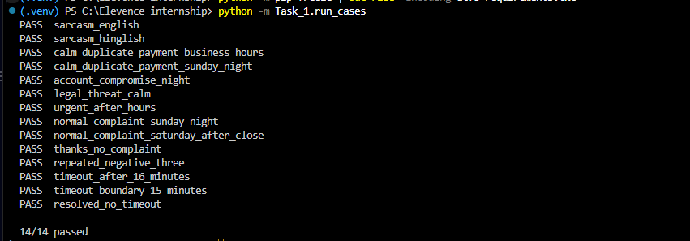

# Task 1: Sentiment Analysis and Escalation

Reads every customer message, understands the mood and risk, adjusts the reply tone and escalates when needed. The full project overview is in the [main README](../README.md).

## Rules

- **Mood and risk.** The LLM returns sentiment (positive, neutral, negative, frustrated, urgent, sarcastic), language, risk type and confidence scores, using the recent conversation history.
- **Escalation triggers:**
  - 3 negative-side messages in a row (negative, frustrated or sarcastic)
  - a high-risk issue (account compromise, duplicate payment, legal threat), even if the customer is calm
  - a negative conversation unresolved for **more than** 15 minutes, checked automatically without a new message
- **Queues.** Business hours are Monday to Saturday, 9:00 to 18:00 IST. Outside them, urgent or high-risk cases go to the **on-call queue** and normal complaints are scheduled for the **next working day**. Inside business hours they go to the agent queue.
- **Tone.** The reply tone follows the mood. The business policy (no refund promises, no sensitive data, no legal arguments) never changes. The next step shown to the customer is written by Python, not by the LLM.
- **Escalation record.** Every escalation stores the reason, the condition that fired and a conversation summary.

## Files

| File | Purpose |
|---|---|
| `config.py` | Business hours, thresholds, simulated clock |
| `analyzer.py` | Groq call: sentiment, language, risk type, confidence |
| `state.py` | Per-conversation memory: negative streak, start of negativity, risk |
| `escalation.py` | The escalation rules and the queue routing |
| `records.py` | Builds and saves escalation records with a summary |
| `responder.py` | Tone-based reply with fixed business policy |
| `pipeline.py` | Runs one message through all steps, and the automatic timeout check |
| `run_cases.py` | Test runner (PASS or FAIL per case) |

## Settings

Everything is in `config.py`: business days and hours, the number of negative messages that escalate, the 15-minute limit. `set_time()` and `clear_time()` simulate the clock for after-hours and timeout tests.

## Test

    python -m Task_1.run_cases

Result: **14/14 passed.** Cases cover sarcasm (English and Hinglish), calm high-risk complaints, after-hours requests, repeated negative messages and the 15-minute boundary (15 minutes does not escalate, 16 does).

 
## Known limits

- `LOW_CONFIDENCE_THRESHOLD` exists in `config.py` but is not used yet (planned with Task 6).
- Labels come from an LLM, so a mood label can differ slightly between runs.