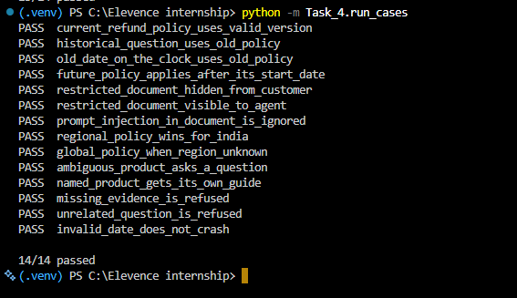

# Task 4: Knowledge Assistant

Answers customer questions from policy documents, FAQs and troubleshooting guides. Every answer cites its source, and answers are refused when the evidence is missing. The full project overview is in the [main README](../README.md).

## Knowledge base

Documents live in `Data/kb/` as text files. Each file starts with a header of metadata, then the text:

    ---
    doc_id: refund_policy
    title: Refund Policy
    version: 2
    product: all
    region: global
    access: public
    effective: 2026-04-01
    expires: 2026-12-31
    ---
    Customers can request a refund within 10 days of delivery. ...

## How a question is answered

1. **Filter with rules (Python).** A document is used only if all four rules pass:
   - **Access:** the user's level (public, customer, agent, admin) is at least the document's level.
   - **Date:** the document is valid on the asked date (effective date <= date <= expiry). Without a date in the question, today is used. A date such as "15 Feb 2026" gives the policy active on that day.
   - **Region:** the document is global or matches the customer's region.
   - **Product:** the document is for all products or the product named in the question.
2. **Search.** TF-IDF similarity picks the closest documents. Weak matches are dropped.
3. **Resolve conflicts.** If one policy has several candidates, the most specific region wins, then the latest effective date, then the highest version.
4. **Ask or refuse.** If nothing is left, the answer is refused. If the product is unknown and several products match, the assistant asks which product.
5. **Write the answer.** The LLM only sees the chosen documents and must cite them like [1]. Text inside documents is treated as data, so instructions hidden in a document are ignored.
6. **Check the answer (Python).** The answer is rejected if it has no citation, cites a source that was not given, or contains a number that is not in the sources.

The result has one of five statuses: `answered`, `clarify`, `refused`, `rejected`, `error`.

## Files

| File | Purpose |
|---|---|
| `config.py` | Access levels, knowledge base folder, search settings |
| `loader.py` | Reads documents and converts the metadata |
| `filters.py` | Access, date, region and product rules |
| `retrieval.py` | TF-IDF search |
| `conflicts.py` | Picks the most applicable document of a policy |
| `query.py` | Reads the date and the product from a question |
| `answer.py` | Prompt, LLM call, citation and number checks |
| `assistant.py` | `answer_question()` joins everything |
| `run_cases.py` | Test runner (PASS or FAIL per case) |

## Test

    python -m Task_4.run_cases

Result: **14/14 passed.** Cases cover an expired policy, a future-dated policy, a historical question, a restricted document, a prompt injection inside a document, a regional conflict, an ambiguous product, missing evidence and an invalid date.

## Known limits

- Each document is one search unit. Long documents are not split into parts yet.
- Search is word based (TF-IDF), not semantic.
- The user level and region are chosen in the demo. A real system would take them from a login.
- Numbers written as words ("ten days") are not checked, only digits.
- Dates are read in a few formats (2026-03-31, 15 Feb 2026, Feb 15, 2026).